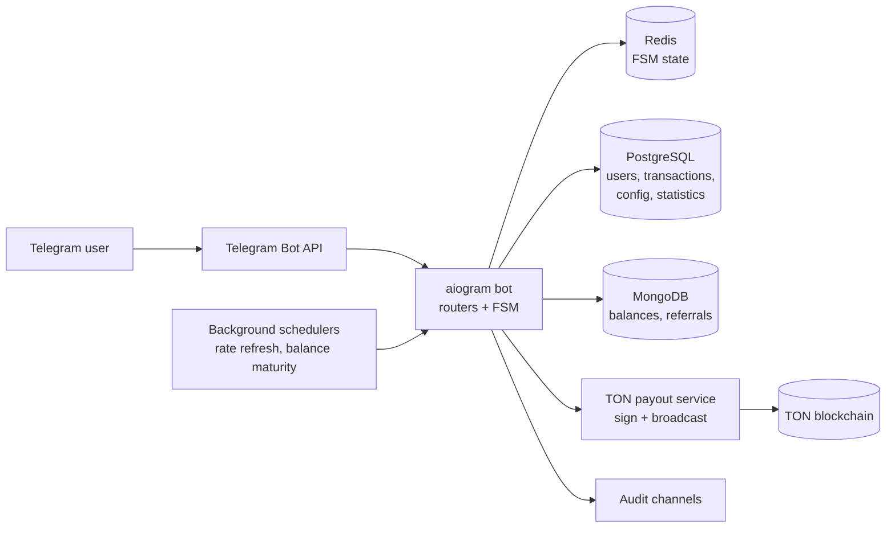
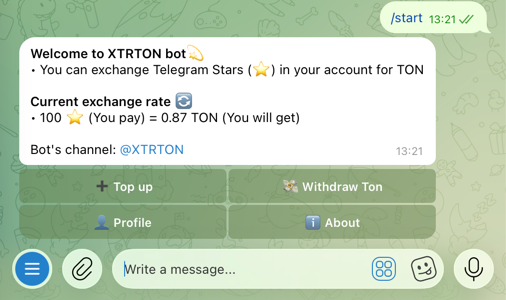
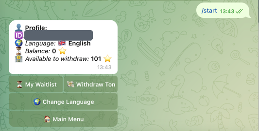
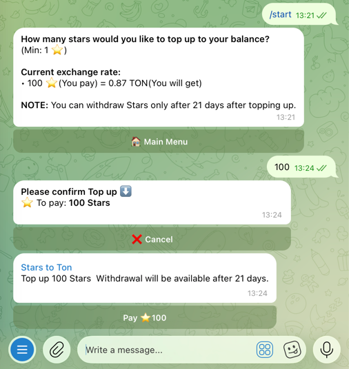
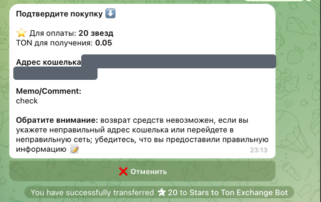
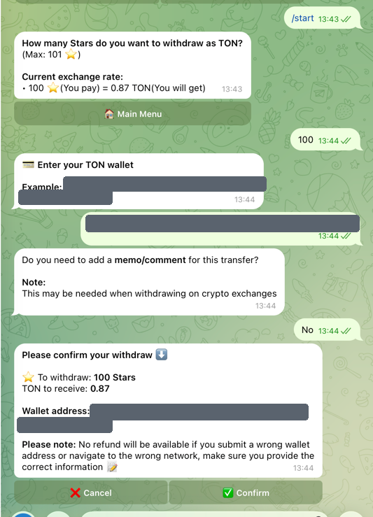

# Stars to TON Exchange Bot

A Telegram bot that lets users exchange Telegram Stars for TON cryptocurrency with fully
automated payouts. A user chooses an amount, pays the Stars invoice inside Telegram, and the
bot signs and broadcasts a TON transfer to the wallet address they supplied — no manual step
and no operator in the loop. It has been running in production since March 2025 and also
handles a deferred "top up now, withdraw later" flow required by Telegram's Stars refund
window, in three languages (English, Russian, Uzbek).

## Status

| | |
|---|---|
| In production since | March 2025 |
| Registered users | 3,000+ |
| Monthly active users | ~100 |
| Exchange volume | $3,000+ |

## Features

### User flows

- **Direct exchange (Stars → TON).** The user enters a Stars amount within configured
  min/max bounds, submits a TON wallet address, optionally attaches a memo/comment (needed
  when withdrawing to a crypto exchange), and reviews a confirmation screen showing the exact
  Stars charged and TON to be received. Paying the Telegram Stars invoice triggers the payout.
- **Balance top-up with a deferred withdrawal.** Users can buy Stars into an internal balance
  and withdraw them as TON after a configurable holding period (currently 21 days). This exists
  because Telegram allows Stars payments to be refunded for a limited window, so paying out
  immediately against refundable Stars is not safe.
- **Waitlist view.** Each pending top-up is listed with its request date, the date it becomes
  withdrawable, and days remaining — available both as a formatted table and as a plain list.
- **Withdrawal from available balance.** Once the holding period has elapsed, the matured Stars
  move from `balance` to `balance_available` and the user is notified with a direct
  "Withdraw TON" button; the withdrawal reuses the same wallet/memo/confirm flow.
- **Profile.** Telegram ID, interface language, held balance, and balance available to withdraw.
- **Live exchange rate.** The rate shown on every screen is recalculated from the current
  TON/USD market price rather than hardcoded.
- **Multilingual interface.** English, Russian and Uzbek, chosen on first start and changeable
  later; the language is persisted per user and used for scheduled notifications too.
- **Referral links.** Deep links that credit the inviter with Stars per invited user.

### Admin and operations

- Runtime configuration over chat commands: minimum and maximum Stars per exchange and the
  exchange rate are stored in the database and reloadable without a restart.
- Broadcast tooling: a multilingual release-note flow that stores one message per language and
  fans it out to active users, automatically marking users who have blocked the bot as inactive.
- Statistics command: total users, new users over the last seven days and today, plus
  cumulative exchange count, Stars received and TON sent.
- Star refunds issued through Telegram's refund API by payment charge ID.
- User blocking/unblocking, enforced by middleware ahead of every handler.
- Two separate audit channels: one for user-interaction events, one for money events
  (Stars received, payout sent, payout failed, balance maturity).
- Automatic deactivation of users who block the bot, via Telegram's `my_chat_member` updates.

## Architecture

**How a payment is verified and paid out, at a high level.** Payment never depends on anything
the client sends: the bot issues a Telegram Stars invoice and only acts once Telegram itself
reports a successful payment for it, so the Stars are confirmed by Telegram before any TON
moves. The payout amount is recomputed server-side from the stored Stars amount and the current
rate rather than taken from the user's message, and the destination address is validated as a
well-formed TON address before the confirmation screen is shown. The payout service then builds,
signs and broadcasts a single transfer, with the optional user memo attached as the transfer
payload. The result is checked, and a failed broadcast returns a distinct outcome: the user is
told the payout failed and pointed at support for a refund rather than being shown a false
success, and the failure is written to the money-events audit channel. For the deferred flow,
balances only become withdrawable after the holding period has elapsed, and the maturity job
refuses to move Stars that would take a balance negative.

## Tech stack

- **Language:** Python 3.12, fully `asyncio`-based
- **Bot framework:** aiogram 3 (routers, FSM, middlewares, Telegram Stars payments: invoices,
  pre-checkout, successful-payment and refund APIs)
- **Databases:** PostgreSQL (users, transactions, runtime config, statistics) and MongoDB
  (balances, referral lists)
- **State store:** Redis, as aiogram FSM storage
- **Blockchain:** TON via `tonsdk` for wallet derivation, message construction and signing;
  Toncenter HTTP API for wallet state and transaction broadcast
- **Scheduling:** APScheduler cron jobs plus long-running `asyncio` background tasks
- **Config:** `pydantic-settings` with secrets kept in a gitignored `.env`
- **Deployment:** long-running `systemd` service on a Linux VPS, with PostgreSQL, MongoDB
  and Redis alongside it

## Engineering highlights

- **Payment triggers are server-confirmed, and amounts are recomputed server-side.** Payout is
  driven by Telegram's `successful_payment` update for the invoice the bot issued, and the TON
  amount is derived from stored state and the current rate, so the user cannot influence what
  is sent by editing a message.
- **A holding period built around a real external constraint.** Because Telegram Stars payments
  are refundable for a window, topped-up Stars are held in a non-withdrawable balance and
  promoted to a withdrawable one by a daily cron job, which notifies the user in their own
  language. The job also guards against negative balances and reports such cases to the
  operator channel instead of proceeding.
- **Payout failures are a first-class path, not an exception that escapes.** The payout call
  returns an explicit success flag; on failure the user gets a clear failure message with a
  support route, the event is logged to the money channel, and no balance is deducted — the
  withdrawal flow only subtracts the user's available balance after a successful broadcast.
- **Structured audit trail separating user events from money events.** Every meaningful step
  (`#exchange_started`, `#stars_received`, `#exchange_FAILED`, `#withdraw_FAILED`,
  balance-maturity updates) is tagged and sent to Telegram channels, which makes production
  incidents traceable after the fact without shell access to the server.
- **Hot-reloadable runtime configuration.** Exchange rate, minimum and maximum Stars live in the
  database; a background task refreshes the rate from the live TON price every few minutes and
  admins can change the bounds over chat, so pricing changes require no deploy.
- **Localisation and access control applied centrally.** A middleware resolves each user's
  language and status before any handler runs, and blocked users are stopped there rather than
  in individual handlers, so a single check covers every entry point.

## Screenshots

<table>
  <tr>
    <td width="50%" align="center">
       
      Main menu, with the live exchange rate
    </td>
    <td width="50%" align="center">
       
      Profile: held balance and balance available to withdraw
    </td>
  </tr>
  <tr>
    <td align="center">
       
      Top-up: amount, confirmation and the Telegram Stars invoice
    </td>
    <td align="center">
       
      Confirmation screen in Russian — the same flow runs in English and Uzbek
    </td>
  </tr>
</table>

   
  Withdrawal: amount checked against the available balance, TON address validation, optional memo, and a confirmation screen showing exactly what will be sent

Wallet addresses and the Telegram ID are masked in these screenshots.

## A note on the source

Source code is private because this is a live service handling real payments. Happy to walk
through the code in an interview.
